# Gustavo Kogien Caraski

[Português](README.md) · **English**

Back-end · e-commerce integrations and automation at [Olimpo Esportes](https://olimpoesportes.com.br) · Systems Analysis student

- 🔌 I connect Shopify, Mercado Livre, Shopee, Amazon, Magalu and TikTok Shop to the ERP and shipping.
- 🧰 I open-source the generic tools that come out of that work: [readme-terminal](https://github.com/ExplorerOf/readme-terminal) made the window above.
- 📫 [LinkedIn](https://br.linkedin.com/in/gustavo-kogien-caraski-5846b2190)
