# Olá, eu sou o Gustavo 👋

**Desenvolvedor na [Olimpo Esportes](https://olimpoesportes.com.br)** e estudante de Análise e Desenvolvimento de Sistemas.

Participo da criação do **Hermes Hub** e de outras soluções internas da empresa: integrações com
marketplaces e ERP, automação de expedição e sistemas de apoio à produção e ao estoque.

[LinkedIn](https://br.linkedin.com/in/gustavo-kogien-caraski-5846b2190) · [Olimpo Esportes](https://olimpoesportes.com.br)

## Stack

*As ferramentas por trás do Hermes Hub e das automações da Olimpo Esportes.*

<table>
  <tr>
    <td align="right"><strong>Linguagens</strong></td>
    <td>
      
      
    </td>
  </tr>
  <tr>
    <td align="right"><strong>Web</strong></td>
    <td>
      
      
    </td>
  </tr>
  <tr>
    <td align="right"><strong>Dados &amp; Infra</strong></td>
    <td>
      
      
      
    </td>
  </tr>
  <tr>
    <td align="right"><strong>E-commerce</strong></td>
    <td>
      
    </td>
  </tr>
</table>

## Contribuições

<picture>
  <source media="(prefers-color-scheme: dark)" srcset="https://raw.githubusercontent.com/ExplorerOf/ExplorerOf/output/github-contribution-grid-snake-dark.svg" />
  
</picture>
